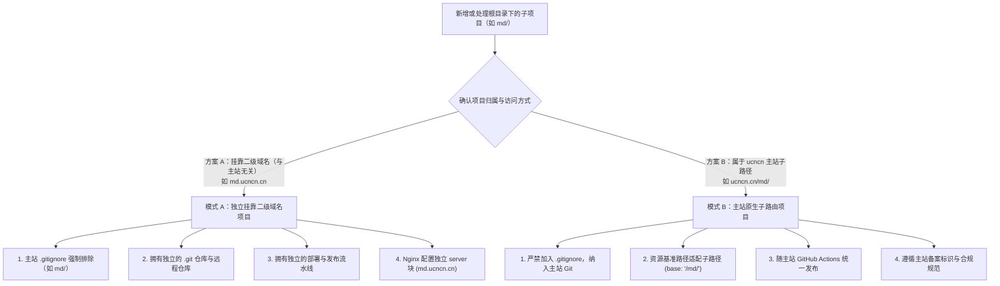

# ucncn 网站项目开发与架构规范 (DEVELOPMENT_SPEC)

> **重要提示（开发者与 AI Agent 必读）**  
> 本代码库（根目录）在本地物理结构上同时存在 **主站自有代码** 与 **挂靠二级域名的独立项目**。  
> **在对任何子文件夹（如新增的 `md/` 或以后的新文件夹）进行开发、修改、打包或提交前，必须严格确认该项目的所属关系与挂靠模式。**

---

## 1. 核心准则：双轨归属确认机制

当需要新增或开发根目录下的某个子目录（以 `md/` 为例）时，开发者 / AI **必须先明确以下两种模式之一**：



---

### 模式 A：挂靠二级域名项目（与 ucncn.cn 主站无关）

- **典型代表**：
  - `money/`：对应二级域名 `m.ucncn.cn`（MoneyLab 搞钱实验室）。
  - `md/`：预留给二级域名（如 `md.ucncn.cn`）或其他独立项目。
- **定位**：
  - 仅在本地物理磁盘上存放于 `ucncn/` 根目录下，方便开发者统一在同一个父文件夹下打开或维护。
  - **在逻辑架构、代码仓库、域名和部署流程上，与 ucncn.cn 主站完全解耦、完全无关**。
- **开发与提交硬性要求**：
  1. **排除在主站提交之外（防污染）**：
     - 主站根目录下的 `.gitignore` 必须将该目录完整忽略（例如已加入 `money/`、`md/`）。
     - 在主站执行 `git status`、`git add .`、`git commit` 时，该目录必须完全隐形，**绝对不能提交到 ucncn 主站仓库**。
  2. **独立 Git 仓库管理**：
     - 该子目录下应建立自己的独立版本库（即该目录下有独立的 `.git/`，如 `cd md && git init`）。
     - 拥有自己独立的远程仓库地址（例如 `https://github.com/ai717/md.git`）。
  3. **独立部署与发布**：
     - 主站的 GitHub Actions 部署工作流（`.github/workflows/deploy.yml`）仅打包主站仓库内的跟踪文件，不会包含任何模式 A 目录。
     - 二级域名项目需自建 CI/CD，或拥有自己独立的部署脚本与线上目录（例如 VPS 上的 `/www/wwwroot/md.ucncn.cn`）。
  4. **Nginx 独立配置**：
     - 在 Web 服务器上必须作为独立的 `server { server_name md.ucncn.cn; ... }` 配置，不与主站 `ucncn.cn` 混用根路径。

---

### 模式 B：ucncn 主站子路由项目（属于 ucncn.cn 体系）

- **典型代表**：
  - `movie/`：对应访问地址 `https://ucncn.cn/movie/`
  - `projects/*`：对应访问地址 `https://ucncn.cn/projects/<slug>/`（如 `ucncn.cn/projects/movie-dna/`）
- **定位**：
  - 属于 `ucncn.cn` 主站自身的有机组成部分，借用主站统一域名与备案号。
- **开发与提交硬性要求**：
  1. **主站版本控制**：
     - **严禁**将此类文件夹加入 `.gitignore`。
     - 代码必须随主站 Git 统一提交、统一打 tag、统一管理。
  2. **静态资源路径（Base URL）适配**：
     - 若为纯静态页面，HTML 中的内部资源引用必须使用相对路径（如 `./static/...`）或子绝对路径（如 `/movie/...`）。
     - 若使用 Vite / Vue / React 构建，打包时配置的 `base` / `publicPath` 必须指定为对应子路由（如 `base: '/md/'`），防止上线后静态资源 404。
  3. **统一自动化部署**：
     - 每次推送到主站 `main` 分支后，由 `.github/workflows/deploy.yml` 自动打包并上传至生产环境 `/www/wwwroot/ucncn.cn`。
  4. **合规提示**：
     - 页面底部需保留备案号链接（如 `苏ICP备2024150485号-5`）。
     - 遵守个人备案合规规范，不涉及商业支付或开放公众发帖。

---

## 2. 当前根目录资产归属盘点表

| 目录/文件 | 所属模式 | 访问路径 / 域名 | 独立 Git 仓库 | 纳入主站 Git/发布 | 说明 |
| :--- | :--- | :--- | :---: | :---: | :--- |
| `index.html` / `generator.js` | 主站核心 | `https://ucncn.cn/` | 否 | **是** | 菜鸟笔记主站核心入口及功能 |
| `assets/` / `static/` / `scripts/` | 主站资源 | `https://ucncn.cn/...` | 否 | **是** | 主站公共静态资源与维护脚本 |
| `notes/` | 主站功能 | `https://ucncn.cn/notes/` | 否 | **是** | 主站笔记内容库 |
| `movie/` | **模式 B**（主站子路由） | `https://ucncn.cn/movie/` | 否 | **是** | 电影基因子页面 |
| `projects/` | **模式 B**（主站子实验室） | `https://ucncn.cn/projects/*` | 否 | **是** | 主站实验室集合（详见 `projects/README.md`） |
| `money/` | **模式 A**（独立二级域名） | `https://m.ucncn.cn/` | **是** | **否**（.gitignore） | MoneyLab 搞钱实验室（独立仓库/独立CNAME） |
| `md/` | **模式 A**（独立二级域名） | `https://md.ucncn.cn/` | **是** | **否**（.gitignore） | **MD2Post Markdown 微信排版工具（已上线独立站点，已挂载至主站实验室卡片）** |
| `tools/` | **模式 A**（独立二级域名） | `https://tools.ucncn.cn/` | **是** | **否**（.gitignore） | **不烧心免费在线工具箱（已上线独立站点，已挂载至主站实验室卡片）** |
| `time/` | **模式 A**（独立二级域名） | `https://time.ucncn.cn/` | **是** | **否**（.gitignore） | **专注时钟 & 倒计时（已上线独立站点，已挂载至主站实验室卡片）** |
| `star/` | **模式 A**（独立二级域名） | `https://star.ucncn.cn/` | **是** | **否**（.gitignore） | **太空偷窥局侦察与反抓捕雷达（已上线独立站点，已挂载至主站实验室卡片）** |

---

## 3. 防误触机制（为什么当前配置可以安全隔离？）

1. **Git 仓库级隔离（`.gitignore`）**：
   - 主站 `.gitignore` 中已明确添加：
     ```gitignore
     # 独立二级域名挂靠项目
     money/
     md/
     ```
   - 效果：即使你在 `md/` 目录下放置了几千个文件或执行了本地构建，主站执行 `git status` 时依然完全保持 clean，不会误把 `md/` 的内容作为主站未跟踪文件提交。
2. **GitHub Actions 自动化部署隔离**：
   - `.github/workflows/deploy.yml` 是通过 `actions/checkout@v4` 从 GitHub 仓库拉取纯净代码并打包上传。
   - 效果：因为 `md/` 和 `money/` 没有被推送到主站 GitHub 仓库，主站线上部署包中 100% 不会包含它们，彻底杜绝污染生产环境。
3. **独立项目的日常操作指引**：
   - 切换到独立项目开发时，请务必进入子目录操作：
     ```bash
     cd md
     git init
     git remote add origin <你的md项目独立远程仓库URL>
     git add .
     git commit -m "feat: init md project"
     git push -u origin main
     ```
   - 切勿在 `ucncn` 主站根目录下使用强制添加命令（如 `git add -f md`）。

---

## 4. 未来拓展其他独立二级域名项目的步骤

如果未来还需要在根目录下临时放置其他挂靠项目（如 `tool/` 对应 `tool.ucncn.cn`）：
1. 立即在根目录 `.gitignore` 文件末尾添加该文件夹名称（如 `tool/`）。
2. 在该文件夹内执行 `git init` 进行独立版本控制。
3. 如果决定将其转为主站子路由（如变成 `ucncn.cn/tool/`），则从 `.gitignore` 中删除该项，并配置静态资源 Base 路径为 `/tool/` 后随主站提交。
