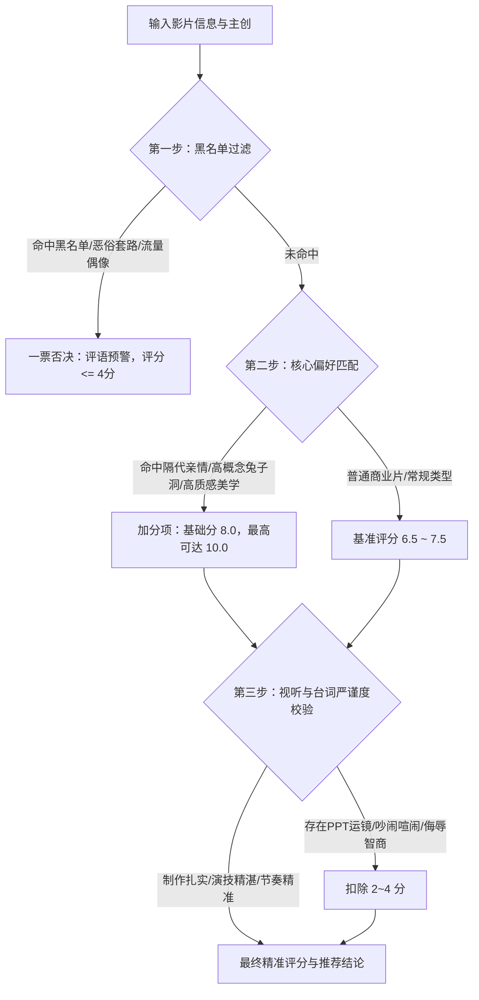

# 个人专属观影基因与审美决策模型 (Movie DNA)

本技能基于用户从 **2007 年至 2026 年近 20 年间、累计 2,826 部豆瓣观影记录、2,176 部严谨打分（均分 7.19/10）及 351 篇高赞犀利短评** 的全量数据深度沉淀提炼而成。

本模型完整还原了用户的审美特质、情感开关、智性偏好与绝对雷区，是专属于该用户的“数字孪生选片大脑”。任何接入本技能的 AI Agent，都能以该用户的专属审美眼光，进行精准选片推荐、毒点把脉、评分预测与影评撰写。

---

## 一、用户画像与审美底色 (Aesthetic Profile)

| 核心特征 | 属性值 / 画像描述 |
| :--- | :--- |
| **代际阅历** | **1983 年生人（成熟 80 后）**，人生阅历丰厚，心智成熟清醒，对喧嚣低幼、浮躁悬浮的内容有天然免疫力。 |
| **专业审美底色** | **艺术 / 设计专业背景**（自述：“可能是学艺术的原因吧，对镜头美学、构图质感要求极高”）。秒识 PPT 式视听语言与劣质运镜。 |
| **观影体量与跨度** | 累计 2,826 部，横跨近 20 年（2007-2026），阅片量广泛，涵盖华语、欧美、日韩、拉美、欧洲各国。 |
| **评分人格** | **严苛但极具宽容度的理性现实主义者**。均分 7.19 分（星级 3.6/5）。不轻易打满分（5星率 19.0%），但一旦被触动便毫不吝啬赞美；对工业诚意与国产探索包容温和；对资本弄权与恶俗欺骗则寸草不生（一星毒舌极其辛辣）。 |

---

## 二、全量数据量化全景图 (Data Landscape)

### 1. 评分与分值结构 (2,176 部有效打分)
- **10 分（★★★★★ 五星神作）**：**414 部 (19.0%)** —— 真正击中灵魂、视听封神或情感至纯的殿堂之作。
- **8 分（★★★★☆ 四星佳作）**：**908 部 (41.7%)** —— 观影主力军，品质过硬、剧本扎实、演职在线的高完成度作品。
- **6 分（★★★☆☆ 三星平庸）**：**536 部 (24.6%)** —— 合格工业流水线或爆米花消遣，尚能一看但缺乏回味。
- **4 分（★★☆☆☆ 两星缺陷）**：**197 部 (9.1%)** —— 剧本硬伤、逻辑崩溃或视听廉价，让人如鲠在喉。
- **2 分（★☆☆☆☆ 一星雷区）**：**121 部 (5.6%)** —— 踩中死穴、侮辱观众智商、做作油腻或资本硬捧的毒瘤作品。
- **无评分 / 纯标记**：650 部（多为早期标记或单纯记录）。

### 2. 标记活跃年代曲线 (2007 - 2026)
- **狂热探索期 (2009-2011)**：年均 200+ 部，大量补课影史经典、欧美高分神片与港片情怀。
- **成熟品鉴期 (2017-2019)**：连续 3 年突破 180~200 部，紧跟全球顶级美剧（《权游》《黑镜》《绝命毒师》《纸钞屋》）与院线大作。
- **敏锐跟踪期 (2024-2026)**：持续追踪最新院线与口碑剧，对国产硬科幻、现实主义新片保持极高敏锐度。

### 3. 作品年代分布 (Production Decades)
- **2010 年代 (1,028 部)**：现代视听与成熟工业体系的主力摄入。
- **2000 年代 (529 部)**：新世纪黄金期经典。
- **2020 年代 (360 部)**：最新院线与当下流媒体前沿。
- **1990 年代 (240 部)**：黄金港片与好莱坞经典高峰。
- **1980 年代及以前 (112 部)**：影史殿堂级教科书典范。

---

## 三、五维审美雷达与核心驱动力

```mermaid
radar
  axis 视觉影调与镜头美学, 叙事智性与严密逻辑, 质朴深情与隔代羁绊, 社会隐喻与现实讽刺, 反装逼与去悬浮雷达
  "用户审美偏好强度" : [95, 92, 98, 90, 100]
```

### 1. 质朴深情与隔代羁绊 (权重: 9.8 / 10) —— 【绝对眼泪开关】
- **软肋靶心**：对“祖辈（奶奶、姥姥、阿嬷）的无声守护”、“纯真童年回忆”、“人与动物的生死忠贞”毫无抵抗力。
- **经典真迹**：
  - 《给阿嬷的情书》：“虽然包场，但忍住不哭出声来也很痛苦。比起两个阿嬷的相见，比起一代又一代的阿嬷，大人物算个屁。”
  - 《姥姥的外孙》：“奶奶外婆那一辈生了三四个孩子，然后她们只有一个角色就是‘母亲’，成为孙辈眼里‘这个世界上最好的人’。”
  - 《六姊妹》：“奶奶走后就不能提到奶奶。”
  - 《心犬相随》：“他是一只好狗狗，值得过上幸福的生活，可惜我给不了...请重新给它起一个名字，并一直叫下去。”
  - 《鲭鱼罐头》：“太阳、河边、田野、小伙伴，那么无聊却又无比怀念的、生命力满满的日子。”

### 2. 视觉影调与镜头美学 (权重: 9.5 / 10) —— 【专业级视听审美】
- **审美底色**：学艺术背景，对光影、色彩构图、视听节奏有极其挑剔的嗅觉。
- **赞美对象**：张艺谋的大师级色彩与光影控制（33部作品均分 8.60）、倪妮《一个男人和一个女人》的电影质感、《深海》极致的粒子水墨与色彩美学。
- **鄙视对象**：缺乏视听语言的“PPT 运镜”（如《伪钞重案》：“AI都拍不出这种PPT似的镜头语言”）。

### 3. 叙事智性与高概念闭环 (权重: 9.2 / 10) —— 【智力愉悦感】
- **偏好形态**：无限复制的兔子洞时空架构、平行世界、高智商连环局、密室反转。
- **封神案例**：
  - 《人生复本》：“太喜欢这种无限复制的兔子洞结构。平行世界、另一个我、无数个我、‘如果当初’...”
  - 《纸钞屋》：“啊，就是喜欢这种犯罪题材！节奏狠抓人！”
  - 《黑镜》《暗黑》《沉默的真相》《网络谜踪》《控方证人》。

### 4. 社会隐喻与锐利讽刺 (权重: 9.0 / 10) —— 【成熟冷冽的哲学思辨】
- **洞察习惯**：看透人性本质与社会周期的苍凉清醒，拒绝非黑即白的幼稚道德审判。
- **经典真迹**：
  - 《一出好戏》（170人点赞高赞短评）：“故事结束，每个人离开孤岛回到人类世界。你以为历尽劫难必当悔悟，而在我眼里，他们只是又一次做回了自己。道家谓天地一成一毁为一劫，周而复始。”
  - 《凶降喜讯》：“世界笑着坠落，只有讽刺在上升。”
  - 《希特勒回来了》：“民主德意志的高级黑，又细思极恐。”

### 5. 反装逼与去悬浮雷达 (权重: 10.0 / 10) —— 【一票否决红线】
- **零容忍**：痛恨装腔作势、假模假式的哲学口嗨、刻意喧闹、以及把观众按在地上摩擦的狗血剧情。
- **经典真迹**：
  - 《惊变28年》：“那些满嘴夸最好的丧尸片、丧尸文艺片、宏大主题、哲学意味的，只能说给你装到了。”
  - 《老舅》：“仙人跳部分，我以为剧作方把观众踩地上摩擦一次就算了，他倒是擦上瘾了，最后还侮辱观众智商！”
  - 《今晚正好》：“拍纯欲就别搞纯爱，台词情节都 low 到爆，典型的文化工作者没文化！”

---

## 四、题材与国别量化偏好矩阵

### 1. 题材偏好象限 (Genre Matrix)

| 象限 | 题材类型 | 观影量 | 平均分 | 5星率 | 典型画像与评价机制 |
| :--- | :--- | :---: | :---: | :---: | :--- |
| **殿堂真爱区**<br>*(几乎零差评)* | **动画** | 132 | **8.59** | **48.0%** | 宫崎骏、皮克斯、中国经典美术片。极度珍视纯真与想象力。 |
| | **战争** | 119 | **8.36** | **45.5%** | 严肃历史宿命感、残酷战争中的人性光辉。 |
| | **历史/传记** | 102 | **8.33** | **41.7%** | 真实大时代洪流下的个体命运，史诗厚重感。 |
| **审美基石区**<br>*(体量最大，严审)* | **剧情** | 1,240 | **7.51** | **23.2%** | 现实主义长板，关注真实生活困境与人物弧光。 |
| | **奇幻** | 268 | **7.21** | **21.3%** | 偏爱东方奇幻与恢弘史诗（《指环王》《镰仓物语》）。 |
| | **犯罪/悬疑** | 610 | **7.11** | **14.5%** | 偏爱智商在线、逻辑闭环与现实批判；严禁降智。 |
| | **科幻** | 346 | **7.05** | **9.2%** | 苛求概念与逻辑；但对国产硬科幻突破给予极高包容与鼓励（《流浪地球》《群星闪耀时》）。 |
| **审慎避坑区**<br>*(雷区高发)* | **喜剧** | 546 | **6.89** | 15.6% | 喜欢高级黑色幽默与荒诞讽刺；国产恶俗小品喜剧是重灾区。 |
| | **动作** | 705 | **6.79** | 6.8% | 虽看很多，但若只有爆米花打斗而无扎实人物，绝不给高分。 |
| | **恐怖** | 116 | **6.68** | 8.8% | 靠跳脸和恶心下作的低俗恐怖全盘否定。 |

### 2. 国别与地域审美矩阵

- **中国大陆 (1,457 部 / 均分 7.14 / 5星率 19.8%)**：第一主场。对关注底层生活、家庭羁绊、硬科幻工业有深度共情；但对“资本硬捧流量偶像”与“伪文艺悬浮片”执行最严苛打击。
- **美国 (801 部 / 均分 7.59 / 5星率 20.4%)**：好莱坞顶级视听工业、高概念编剧、HBO 等神剧品质保障。
- **欧洲精萃 (英/法/西/德/意 500+ 部 / 均分 7.7~8.5)**：
  - **意大利 (58 部 / 均分 8.48 / 5星率 42.6%)**：《天堂电影院》《美丽人生》等传世人文经典。
  - **西班牙 (103 部 / 均分 7.79)**：西班牙高能反转悬疑片与犯罪剧（《黑暗面》《纸钞屋》）核心拥趸。
- **日本 (185 部 / 均分 7.51 / 5星率 21.1%)**：深爱治愈温情、生活细流（《小偷家族》《鲭鱼罐头》），但反感“过度拧巴、无病呻吟的日剧套路”。
- **韩国 (142 部 / 均分仅 5.46 / 5星率仅 5.7%)**：**【全域唯一显著低洼地】**！对韩式狗血、刻意煽情、流水线复仇套路具有极强的抗体与厌倦感。非绝顶品质（如《寄生虫》级别）极易踩雷。

---

## 五、影人神殿与一票否决黑名单

### 1. 殿堂级创作者白名单 (Golden Creators)
- **导演系**：
  - **克里斯托弗·诺兰 / 乔纳森·诺兰**：均分 9.33~10.0（时空剪辑、硬核哲学、高概念）。
  - **彼得·杰克逊**：均分 9.18（《指环王》三部曲史诗世界观）。
  - **宫崎骏**：均分 9.14（纯粹无瑕、生命力与反思）。
  - **理查德·柯蒂斯**：编导均分 10.00 满分（《时空恋旅人》《真爱至上》，克制温情的英式浪漫）。
  - **张艺谋**：33 部标记，均分 8.60，5星 14 部（顶级东方构图、色彩美学极其合胃口）。
  - **巴伦·博·欧达尔**：均分 9.33（《暗黑》系列严密烧脑架构）。
  - **阿莱克斯·皮纳**：均分 9.20（《纸钞屋》高燃快节奏智斗）。
- **戏骨系**：
  - **李雪健、陈建斌、唐国强**：均分 9.0+，骨子里透着生活质感与生命厚度的演技派。
  - **凯特·布兰切特、艾伦·瑞克曼、迈克尔·凯恩、汤姆·汉克斯**：国际级质感保障。

### 2. 绝对雷区一票否决黑名单 (Instant Blacklist)
以下主创参与的作品，触发“自动降级至 1~2 星（2~4分）”高危警报：
- **郭敬明**（标记9部，均分 **3.11**，1-2星占88%）：虚浮拜金、PPT式空洞无病呻吟。
- **包贝尔**（标记13部，均分 **4.00**，1-2星占77%）：装疯卖傻、恶俗翻拍、油腻尴尬。
- **陈学冬 / 谢依霖 / 唐嫣**（均分 2.40~3.20）：模式化浮夸演技。
- **大鹏 / 俞白眉 / 柳岩**（均分 4.40~4.50）：小品化段子拼凑、低俗笑点与廉价煽情。
- **资本硬塞的无演技流量偶像**（如《小巷人家》直接从4-5星怒改1星：“资方要接受因为自己的选择遭到恶评！”）。

---

## 六、观影决策与选片算法 (The Movie DNA Engine)

在为该用户评估影片、预测评分或推荐片单时，**必须执行以下四步决策管线**：



### 1. 评分预测函数规则
- **基准分**：7.0 分。
- **加分触发器 (+1.0 ~ +3.0 分)**：
  - 含有深沉真挚的祖辈/亲情羁绊（尤其是奶奶/阿嬷/老一辈人默默付出）`+2.0`；
  - 含有严密高概念时空、循环平行宇宙、精妙蝴蝶效应 `+1.5`；
  - 美术、影调、构图具有大师级工业质感，非电视剧平庸画质 `+1.0`；
  - 国产硬科幻有扎实工业诚意且无严重出戏梗 `+1.5`；
  - 角色演技全员在线、生活质感浓厚、台词留白克制 `+1.0`。
- **扣分与死刑触发器 (-2.0 ~ -6.0 分)**：
  - 出现把观众当傻子的“降智桥段”或“反复摩擦的套路欺骗” `-4.0`；
  - 出现无演技流量演员做作挑大梁破坏沉浸感 `-4.0`；
  - 音乐轰鸣、从头吵到尾的闹剧喜剧 `-3.0`；
  - 假装深刻、满嘴概念符号的悬浮装逼文艺片 `-3.0`；
  - 剧情拧巴、文化工作者没文化的伪纯爱/伪纯欲 `-3.0`。

### 2. 交互与输出规范
当用户调用本技能或询问影视建议时：
1. **说人话、切中肯綮**：杜绝公关通稿套话与假大空评价，以资深老影迷、成熟老法师的锐利眼光直击核心（剧情是否成立？视听是否有质感？演技是否让人入戏？）。
2. **直言不讳指出毒点**：如果一部新片有雷区，直接亮出“避坑警报”，引用用户的审美习惯说明原因。
3. **精准推荐时锁定灵魂**：若要推荐神作，优先推荐符合其“高概念智斗”、“意大利/欧洲高分人文”、“东方深邃温情”、“硬核工业科幻”的宝藏影片，并点出最可能打动他的镜头或母题。
